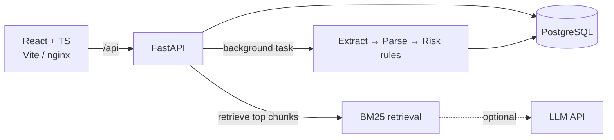

# KYC Case Manager

A full-stack compliance workflow app. A reviewer opens a customer **case**, uploads identity documents, and the system **extracts the fields, runs rule-based risk checks (including fuzzy sanctions screening), and scores the case**. The reviewer then moves the case through an audited approval workflow. An **"Ask about this case"** assistant answers questions using only that case's data, with cited sources.

> All names, documents and the sanctions list in this repo are **fictional sample data**. Do not upload real personal documents to a demo deployment.


## Features

- **JWT authentication** with two roles (`admin`, `reviewer`), bcrypt password hashing
- **Case management**: create, search, filter by status / minimum risk, paginate, dashboard stats
- **Document pipeline** (runs as a background task): text extraction (PDF, OCR for PNG/JPG, TXT) → field parsing (name, DOB, ID number, expiry) → risk evaluation
- **Rule-based risk engine** with a 0-100 score and LOW / MEDIUM / HIGH level (see table below)
- **Fuzzy sanctions screening** with RapidFuzz (catches typos and word-order changes)
- **Review workflow** with enforced transitions and business rules, plus a full **audit log**
- **Ask about this case**: BM25 retrieval over the case's own data, then an LLM (optional) or an extractive fallback. Answers cite their sources and never see other cases' data
- React + TypeScript dashboard, Docker Compose setup, GitHub Actions CI, 60 automated tests

## Architecture



```
backend/app/
  routers/    auth.py · cases.py · documents.py        (HTTP layer, validation, permissions)
  services/   extraction.py · risk.py · sanctions.py · pipeline.py · qa.py · audit.py
  models.py · schemas.py · security.py · deps.py · config.py · database.py
backend/alembic/   database migrations
backend/tests/     60 tests (unit + API)
frontend/src/      pages · components · api client · auth context
```

Design choice: `services/risk.py` is **pure functions with no database access**, so every rule is unit-tested in isolation. The routers stay thin.

## Quick start (Docker)

```bash
cp .env.example .env        # optional: set your own admin password / JWT secret
docker compose up --build
```

- App: http://localhost:8080 (log in with `ADMIN_EMAIL` / `ADMIN_PASSWORD`, defaults `admin@example.com` / `admin12345`, or register a reviewer)
- API docs (Swagger): http://localhost:8000/docs

Migrations run automatically on backend start.

## Local development (without Docker)

Backend (Python 3.12+; SQLite works for a quick run, Postgres is the real target):

```bash
cd backend
python -m venv .venv && source .venv/bin/activate
pip install -r requirements-dev.txt
export DATABASE_URL=sqlite:///./dev.db ADMIN_EMAIL=admin@example.com ADMIN_PASSWORD=admin12345
alembic upgrade head
uvicorn app.main:app --reload
```

Frontend:

```bash
cd frontend
npm install
npm run dev          # http://localhost:5173, proxies /api to localhost:8000
```

OCR for images needs the Tesseract binary (`apt install tesseract-ocr`); PDFs and `.txt` need nothing extra.

## Try it with the sample documents

Upload files from [`sample_data/`](sample_data/README.md) to see each rule fire. For example, create a case named **Rodrigo Valmont Estrada** and upload `sanctions_hit_id.txt` → `SANCTIONS_MATCH`, score 60, HIGH.

## Risk rules

| Rule | Points | Triggers when |
|---|---|---|
| `SANCTIONS_MATCH` | 60 | Customer name or a document name is ≥ 90% similar to a sanctions-list entry |
| `DOC_EXPIRED` | 30 | A document's expiry date is in the past |
| `NAME_MISMATCH` | 25 | A document's name is < 85% similar to the case's customer name |
| `UNDERAGE` | 20 | Date of birth gives an age under 18 |
| `MISSING_FIELDS` | 10 | A document has no ID number or no date of birth |

Score = sum of points, capped at 100. **LOW** < 30 ≤ **MEDIUM** < 60 ≤ **HIGH**. The same list is served live at `GET /rules`.

## Workflow rules (enforced by the API)

- Allowed transitions: `PENDING → IN_REVIEW → APPROVED | REJECTED`, `IN_REVIEW → PENDING`, and reopening a decided case back to `IN_REVIEW`
- Rejecting requires a note
- **High-risk cases can only be approved by an admin**
- Only an admin can reopen a decided case, assign cases, or delete cases
- Every change is written to the audit log (who, what, when, old → new status, note)

## API overview

| Method & path | Purpose |
|---|---|
| `POST /auth/register` · `POST /auth/login` · `GET /auth/me` · `GET /auth/users` (admin) | Auth |
| `POST /cases` · `GET /cases` (`status`, `risk_min`, `q`, `page`, `page_size`) · `GET /cases/stats` | Create, list, dashboard counts |
| `GET /cases/{id}` · `GET /cases/{id}/flags` · `GET /cases/{id}/audit-log` | Read a case |
| `PATCH /cases/{id}/status` · `PATCH /cases/{id}/assign` (admin) · `DELETE /cases/{id}` (admin) | Workflow |
| `POST /cases/{id}/documents` | Upload (PDF / PNG / JPG / TXT, max 5 MB); processed in the background |
| `POST /cases/{id}/evaluate` | Re-run the risk engine |
| `POST /cases/{id}/ask` | Ask a question about the case |
| `GET /health` · `GET /rules` | Meta |

## Configuration

| Variable | Default | Notes |
|---|---|---|
| `DATABASE_URL` | local Postgres | `sqlite:///./dev.db` works for quick local runs |
| `JWT_SECRET` | dev placeholder | **Change in any real deployment** |
| `ADMIN_EMAIL` / `ADMIN_PASSWORD` | unset | Creates an admin on startup |
| `ANTHROPIC_API_KEY` | unset | Enables LLM answers; otherwise answers are extractive (no external call) |
| `LLM_MODEL` | `claude-sonnet-5-5` | Model used when a key is set |
| `UPLOAD_DIR`, `MAX_UPLOAD_MB`, `CORS_ORIGINS` | `uploads`, `5`, `http://localhost:5173` | |

## Tests

```bash
cd backend
pytest --cov=app --cov-report=term-missing
```

60 tests, about 96% line coverage. They cover every risk rule (including boundaries such as "expires today" and "exactly 18"), auth and permissions, the full workflow, the upload pipeline (bad types, empty and oversized files, path-traversal filenames, corrupt PDFs), and Q&A with and without an LLM. The LLM call is mocked, so tests never touch the network. CI (`.github/workflows/ci.yml`) runs the backend tests with a coverage gate, builds the frontend, and builds the Docker images.

## Limitations and what I'd do next

- Field parsing uses regex over labelled text; real passports/IDs would need a layout-aware or ML extractor
- The sanctions list is a small fictional sample; a real system would ingest and refresh official lists (OFAC, UN, EU) on a schedule
- Background processing uses FastAPI `BackgroundTasks`. Under heavy load I'd move to a queue (Celery/RQ + Redis) with retries
- Uploaded files live on a local volume; production would use object storage (S3) with encryption at rest
- Add refresh tokens / token revocation, rate limiting, and per-case access control
- Add Playwright end-to-end tests to CI
